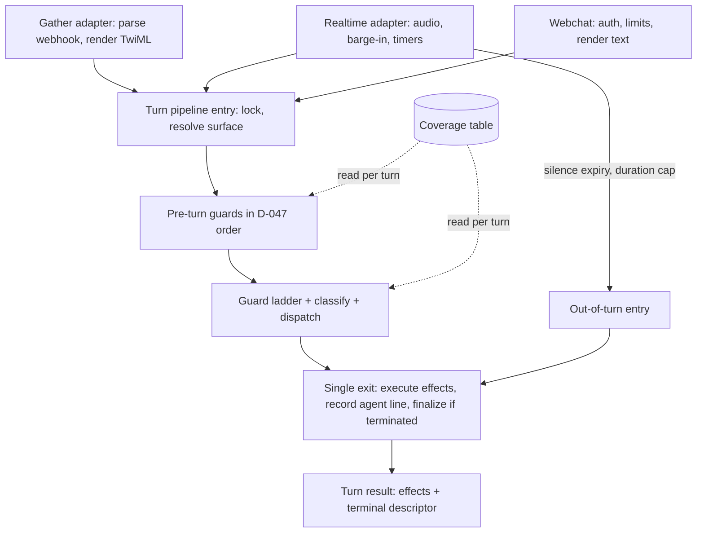

# refactor: Turn pipeline stage 1 — webchat declared, Gather on the pipeline, holes closed

**Created:** 2026-11-11
**Depth:** Deep
**Status:** plan
**Decision:** D-047 (`docs/decisions.md`). This plan implements its points 7(a)–(d). Stage 2 (in-app voice) is a separate plan.

Line numbers below were read on `main` @ `97d66d58` and are navigational hints. Verify each before editing (`docs/solutions/workflow-issues/adversarially-verify-plan-units-before-execution.md`).

Shorthand: **P** = `packages/api/src/ai/voice-turn/create-voice-turn-processor.ts`, **T** = `packages/api/src/telephony/twilio-adapter.ts`, **MS** = `packages/api/src/telephony/media-streams/mediastream-adapter.ts`, **FSM** = `packages/api/src/ai/agents/customer-calling/transitions.ts`.

## Summary

The per-turn guard ladder is written twice for the phone: `speechTurn` (P:5964-6820, realtime and webchat) and `_handleGatherLocked` (T:2502-3216). This plan makes the Turn pipeline the only owner of that ladder for the phone and webchat, routes Gather through it behind a per-tenant flag, then opens the three declared Gather holes and adds the ladder-shaped safety gaps once. It ends by deleting the old Gather ladder.

## Problem Frame

Gather calls 27 of the processor's 31 exported steps in a hand-kept order, so a guard added to one ladder is missing from the other until someone copies it. Today that means:

- the archived-caller hand-off exists only in `speechTurn` (P:6426-6441) and is not declared in the Coverage table;
- three families are declared holes on Gather (consent capture, post-quote assent, emergency immediate dial);
- neither phone Transport handles a caller saying goodbye;
- webchat runs `speechTurn` under the realtime configuration with no session lock and no safety scan (`packages/api/src/webchat/webchat-service.ts:299-352`).

Callers on the default Transport are the ones affected.

## Requirements

- R1. Webchat is a declared Surface in the Coverage table, with no behaviour change from declaring it.
- R2. The Surface is read from the session per turn, and survives a realtime-to-Gather degrade.
- R3. The pipeline has one exit that always records the agent's line and finalizes a terminated session.
- R4. The pipeline takes the session lock itself; no caller holds it around a turn.
- R5. Pre-turn guards run inside the pipeline in D-047's order on every Surface: owner-line re-check, safety scan, duration cap, frustration, pending approval, silence, low-confidence gate, vulnerability triage, classify.
- R6. With the flag on, a Gather turn runs through the pipeline; with it off, the old ladder runs unchanged.
- R7. The Gather-adapter test suites pass unmodified in both flag states, apart from assertions this plan names.
- R8. The three Gather holes are opened one at a time, each with its Coverage-table cell and behaviour pin flipped in the same change.
- R9. Farewell is handled on every Surface; no turn in any state ends with nothing spoken; an emergency phrased as an answer is not consumed as an answer.
- R10. The old Gather ladder, the flag, and the processor exports only Gather used are deleted two weeks after rollout reaches 100%.

## Key Technical Decisions

- **The flag is a platform flag scoped by tenant id, default off, resolved once at session establishment and stored on the session.** A ladder must not change mid-call. This follows `voice_extended_intents` (`packages/api/src/flags/voice-flags.ts:33`, read at T:1256). A read failure selects the old ladder. Rollout uses the existing `PUT /api/admin/feature-flags/:name` with `tenantIds` (`packages/api/src/app.ts:8356`), so no new route. The key is not added to `OWNER_CAPABILITIES` (`packages/api/src/routes/settings.ts:250`); owners must not toggle it. (Alternative: read per turn — rejected, a mid-call switch would split one call across two ladders.)
- **`VoiceSession` gains a `surface` field; the pipeline resolves `session.surface`, falling back to the processor's constructed default.** Many Gather tests hand-build sessions with `store.create` and never call `handleInbound` (for example `packages/api/test/telephony/gather-confirm-question-1476.test.ts:74`), so the Gather entry stamps the field when it is unset. The degrade route (`packages/api/src/routes/telephony.ts:756-822`) stamps `gather`. (Alternative: a second processor instance per Surface — rejected, it cannot follow a degrade.)
- **The pipeline's caller-turn entry returns a turn result, not a bare effects list.** Gather's low-confidence cap ends in voicemail `<Record>` TwiML (T:3354-3378), which effects cannot express. The result carries the effects plus a terminal descriptor the Transport renders. `speechTurn` stays as a thin form of the same entry until its three other callers move (the realtime host wrapper T:2173-2262, webchat, `packages/api/src/ai/voice-quality/text-mode-driver.ts:542`).
- **Scope of D-047's "four entry points" in this stage:** run-a-caller-turn and handle-an-out-of-turn-event are built here. Establish-a-session and end-a-session stay where they are (`establishInboundSession` T:1236, `finalizeTerminatedSession` P:3967) and only gain surface and flag stamping. Moving establishment is not needed to delete the Gather ladder and would widen every unit. This narrows D-047 point 4 for stage 1 only.
- **Adapter-owned work the pre-turn guards need is injected as ports.** The safety scan depends on the reviewed emergency script, the page ladder (`armEmergencyPageLadder` T:2144) and the recording-objection handler (T:2051). The pipeline calls them through ports; a Surface that cannot page (webchat) supplies none and the guard degrades to the spoken line plus the existing escalation.
- **Duration cap is a pre-turn check on Gather and an out-of-turn event on realtime.** Realtime keeps its timers (MS:4282-4447), per D-047 point 6.
- **Both flag states are tested by running the same Gather suites twice.** There is no shared adapter helper across the 73 files, so the flag default lives in one small module that a second vitest config flips through a setup file. No test file is edited to add the variant. (Alternative: `describe.each` in 73 files — rejected as churn in the safety net itself.)
- **The "proceed" recursion carries accumulated effects forward.** Research found the discard at P:6114 and P:6153 is latent, not live: no path reaches it with non-trivial effects today. It is fixed as part of the single exit and pinned, not treated as an incident.
- **Webchat's cells mirror what runs today.** Families whose gate is open under the realtime configuration stay `reachable`, marked `hole: true` where the dependency is unwired (lookup and en-route bundles, on-call repo). Closing them is a product decision outside this plan.

## Scope Boundaries

**In scope:** the Coverage table, the processor, the Gather adapter's turn loop, the realtime host wrapper, webchat's turn call, the flag, the dual-run test configuration, the rollout runbook.

**Non-goals:**
- In-app voice and recorded memos (D-047 stage 2 and D-045).
- The emergency keyword fixes (separate, first).
- Unifying the low-confidence streak with the state machine's retry cap (#965).
- Extending the LLM sentiment check to Gather.
- Moving session establishment into the pipeline.

### Deferred to follow-up work
- Wiring lookup and en-route bundles for webchat, or declaring them refused.
- Splitting P (6.9K lines) into a declarative guard list.
- Migrating ladder-behaviour tests from the adapter to the pipeline, beyond what U10 needs.

## Repository invariants touched

- **Audit events:** no new mutation. The single exit must keep every existing audit write; U3 pins the three early returns that skip the transcript append today.
- **Human-approval gate:** pending voice approval keeps its place ahead of silence and the confidence gate (T:2647-2649 states it must never be suppressed by a shaky confidence score). The S1 proposal allowlist is untouched.
- **LLM gateway:** no call is added outside `packages/api/src/ai/gateway`. U7 and U8 remove classifier calls on some turns.
- **Entity resolver:** unchanged. Disambiguation stays a spoken `voice_clarification`.
- **Tenant isolation:** the flag read goes through `PgTenantFeatureFlagRepository`; U5 adds a real-Postgres test.
- **Integer cents, catalog resolver:** not touched.

## High-Level Technical Design

Sequencing: U1–U4 change shared code with the flag absent and must be behaviour-neutral for Gather. U5 introduces the flag. U6 gates rollout. U7–U9 land only on the pipeline path. U10 deletes.

## Implementation Units

### U1. Declare webchat in the Coverage table
- **Goal:** webchat is a fifth Surface with a cell for each of the 11 families.
- **Requirements:** R1
- **Dependencies:** none
- **Files:** `packages/api/src/ai/voice-turn/coverage-table.ts`; `packages/api/src/webchat/webchat-service.ts`; `packages/api/src/app.ts` (webchat processor construction near 5512); `packages/api/src/capabilities/capabilities.ts`; `packages/api/src/ai/voice-quality/corpus/loader.ts`; `packages/api/src/routes/assistant.ts` (only if its import breaks); tests: `packages/api/test/ai/voice-turn/coverage-table.structural.test.ts`, `packages/api/test/ai/voice-turn/coverage-table.behavior.test.ts`, `packages/api/test/capabilities/capability-declarations.test.ts`, `packages/api/test/proposals/drafting-surface-parity.test.ts`, `packages/api/test/voice-quality/runner.test.ts`, `packages/api/test/webchat/webchat-service.test.ts`.
- **Approach:** add `webchat` to `LIVE_SURFACES`. Each webchat cell's `module` string must contain the same branch token the realtime cell has wherever the gate is open today, so `familyServedByDeclaredCell` (P:634-640) returns the same answer. Mark unwired families `hole: true` with the reason. Build the webchat processor with `coverageSurface: 'webchat'`.
- **Patterns to follow:** existing cells and their reason text; the header comment's cell semantics.
- **Test scenarios:**
  - Structural: every family has a webchat cell; the test fails if one is removed.
  - Neutrality: for each family, the gate answer for `webchat` equals the answer for `media_streams` before this change.
  - Behaviour anchors: one webchat turn each for consent capture reachable, language switch closed, emergency immediate dial not firing (no on-call repo).
  - Existing webchat turn tests pass unmodified.
- **Verification:** webchat replies in the existing tests are byte-identical; the table has 55 declared cells.

### U2. Surface on the session
- **Goal:** the pipeline reads the Surface per turn from the session.
- **Requirements:** R2
- **Dependencies:** U1
- **Files:** `packages/api/src/ai/agents/customer-calling/voice-session-store.ts`; P (the 15 `servesFamilyHere` call sites and the hard-coded `'gather'` at P:5761); T (`establishInboundSession` 1236, `handleInboundForStream` 1173, `initializeStreamSession` 1698, `handleGather` 2491); `packages/api/src/routes/telephony.ts` (gather-fallback 756-822); `packages/api/src/webchat/webchat-service.ts:269`; test: new `packages/api/test/ai/voice-turn/session-surface.test.ts`; `packages/api/test/telephony/gather-fallback-route.test.ts`.
- **Approach:** `servesFamilyHere(family)` becomes session-aware; resolution is `session.surface ?? constructed default`. Stamp at establishment per Transport, at the degrade route, and at the Gather entry when unset. Move the low-confidence streak onto the session so it crosses a degrade (today two maps: T:920 and P:1392).
- **Patterns to follow:** `persistChannel` stamping in webchat; `extendedIntents` on session context.
- **Test scenarios:**
  - A session stamped `gather` on a processor built as `media_streams` gates as Gather.
  - An unstamped session uses the constructed default.
  - Degrade: a realtime session with a low-confidence streak of 1 continues on Gather with streak 1 and Surface `gather`.
  - A hand-built session entering `handleGather` is stamped `gather`.
- **Verification:** the Layer 1 driver still resolves to `gather`; no cassette drift.

### U3. Single exit and turn result
- **Goal:** every path out of a caller turn runs the same exit.
- **Requirements:** R3
- **Dependencies:** U2
- **Files:** P (all 32 returns inside `speechTurn`; the exit at P:6789-6817; the recursions at 6114 and 6153); `packages/api/src/telephony/media-streams/mediastream-adapter.ts` (`SpeechTurnHandler` type 177-203); tests: new `packages/api/test/ai/voice-turn/turn-single-exit.test.ts`; existing `packages/api/test/ai/voice-turn/speechturn-service-area-1567.test.ts`, `speechturn-caller-identity-check-1331.test.ts`.
- **Approach:** guards return their effects to one exit that executes effects, appends the agent line, and finalizes when the state machine is terminated. Fix the three returns that skip the append (P:6082, 6134, 6691). The ported silence ladder (P:6072) stops finalizing on its own. The recursion carries accumulated effects. Introduce the turn result with a terminal descriptor; `speechTurn` keeps returning the effects from it.
- **Patterns to follow:** `finalizeTwiml` (T:3429-3472), which already does this on every Gather return.
- **Test scenarios:**
  - Each of the three formerly silent-append paths now records the agent line once.
  - No path records it twice (the realtime host and Gather's `finalizeTwiml` also append today; pin exactly-once per turn).
  - A guard that terminates the state machine from an early position runs finalize and the terminated callback once.
  - Proceed after an identity check: effects accumulated before the recursion appear in the result.
  - Low-confidence cap returns a terminal descriptor, and realtime still speaks its call-back line.
- **Verification:** `packages/api/test/telephony/gather-ladder-cap-lcr02.test.ts` and `gather-max-call-duration.test.ts` still see `runSummary` called once.

### U4. Pipeline owns the lock and the pre-turn guards
- **Goal:** lock and pre-turn order live in the pipeline; the realtime host wrapper shrinks to rendering.
- **Requirements:** R4, R5
- **Dependencies:** U3
- **Files:** P; T (`processCallerUtterance` 2173-2262, `runDeterministicSafetyScan` 1808-1848, `runEmergencyScan` 1862-2012, `maybeEndForMaxCallDuration` 3239-3279); MS (lock sites 1677, 2320, 2503, 3155, 4377, 4506; the confidence gate 2279-2285; triage 2437-2459); `packages/api/src/ai/voice-turn/shared/` (new pre-turn module); `packages/api/src/ai/voice-quality/text-mode-driver.ts` (drop its own emergency scan copy, 571-575); tests: new `packages/api/test/ai/voice-turn/pre-turn-order.test.ts`; `packages/api/test/voice-quality/text-mode-driver.structural.test.ts`; `packages/api/test/telephony/media-streams/*` as affected.
- **Approach:** add the caller-turn entry that takes `withSessionLock` and calls the locked inner turn; the recursion calls the inner turn (the lock is not reentrant, `voice-session-store.ts:1158-1178`). Add the out-of-turn entry for silence expiry and the duration cap, also self-locking. Move the guards in D-047's order; the turn input gains an optional confidence. Realtime-only mechanics stay in MS: interim scan, latch, timers, barge-in, reply-gap anchors (MS:2221-2246).
- **Patterns to follow:** `shared/low-stt-ladder.ts`, `shared/max-call-duration.ts` (rules shared, rendering per Transport).
- **Test scenarios:**
  - Order: a turn that is both a keyword emergency and low-confidence runs the safety scan, not the reprompt (this is the intended realtime change).
  - Order: pending approval is consumed before the confidence gate.
  - Lock: two concurrent turns on one session run serially; a proceed recursion does not deadlock.
  - A caller that still wraps the entry in `withSessionLock` is caught by a structural test, not by a hang.
  - Realtime: reply-gap anchors are armed before the pipeline is entered.
  - Driver structural test: the driver carries no scan of its own.
- **Verification:** Layer 1 corpus passes with no cassette refresh, or the refresh is committed with the diff explained.

### U5. Flag and Gather routing
- **Goal:** with the flag on, `handleGather` calls the pipeline and renders its result.
- **Requirements:** R6, R7
- **Dependencies:** U4
- **Files:** `packages/api/src/flags/voice-flags.ts`; new `packages/api/src/telephony/gather-ladder-default.ts`; T (`handleGather`, establishment, `finalizeTwiml`, `endLadderWithVoicemail`); `packages/api/src/app.ts` (wire the resolver near 4235); new `packages/api/vitest.gather-pipeline.config.mts` and its setup file under `packages/api/test/helpers/`; `.github/workflows/pr-checks.yml` (second run of the Gather suites); tests: new `packages/api/test/telephony/gather-pipeline-routing.test.ts`; new `packages/api/test/integration/gather-pipeline-flag.test.ts`; `packages/api/test/app/wiring.test.ts`.
- **Approach:** resolve the flag at establishment and store it. Flag on: parse the webhook, call the caller-turn entry with the utterance and confidence, render effects and the terminal descriptor through the existing `finalizeTwiml` and `buildTwiML`. Stays in the adapter: unknown-session restart (T:2503-2537), parked-transfer hand-back, safety `<Say>` injection, Gather hints, the `timing{transport:'gather'}` stamp. Gather gains the archived-caller hand-off and the early existing-customer reply by construction; add the archived-caller cell.
- **Patterns to follow:** `resolveExtendedIntents` (T:3528-3538); stubbed flag deps in `packages/api/test/telephony/media-streams/telephony-realtime-fallback.test.ts:109`.
- **Test scenarios:**
  - Flag off: the old ladder runs (spy on the pipeline entry: not called).
  - Flag on: the pipeline entry is called once per webhook; TwiML for a booking turn matches the old ladder's.
  - Flag read throws: old ladder.
  - Flag flipped mid-call: the call keeps the ladder it started with.
  - Archived caller on Gather, flag on: hand-off line and escalation.
  - Low-confidence cap, flag on: voicemail `<Record>` TwiML, summary once.
  - Integration (Docker): a platform flag row with `tenantIds` enables tenant A and not tenant B.
  - The full Gather suite list passes under `vitest.gather-pipeline.config.mts`; any file that needs an edit is listed in the PR with the reason.
- **Verification:** both CI runs green; a diff of TwiML across the two runs for the characterization suites shows only the two intended gains.

### U6. Rollout runbook and comparison signal
- **Goal:** an operator can advance and roll back the flag and see whether the two ladders differ in production.
- **Requirements:** R6
- **Dependencies:** U5
- **Files:** new `docs/runbooks/voice-gather-pipeline-rollout.md`; `packages/api/src/monitoring/metrics.ts` (a ladder label on existing turn-outcome counters); test: `packages/api/test/monitoring/` (the label is emitted).
- **Approach:** entry gate is the voice-quality harness on the Gather Surface (Layer 1 on every PR; Layer 2 via `voice-quality:layer2`). Steps: demo tenant, a small set of real tenants, everyone, advancing on call count. Rollback is removing the tenant from `tenantIds`. Record the date 100% is reached; U10 is due two weeks later.
- **Patterns to follow:** `docs/runbooks/voice-realtime-rollout.md`.
- **Test scenarios:** the counter carries `ladder=old|pipeline`. Runbook: `Test expectation: none — documentation`.
- **Verification:** escalation rate, clarification rate and call length can be compared by ladder.

### U7. Open the three Gather holes, one change each
- **Goal:** consent capture, post-quote assent and emergency immediate dial are reachable on Gather.
- **Requirements:** R8
- **Dependencies:** U5 (pipeline path only)
- **Files:** `packages/api/src/ai/voice-turn/coverage-table.ts`; P (branches at 6049-6056, 6200-6249, 6646-6701); tests: `packages/api/test/ai/voice-turn/coverage-table.behavior.test.ts` (pins near 529, 574, 617), `packages/api/test/ai/voice-turn/speechturn-absorbs-gather-delta.test.ts`; cassettes under the voice-quality corpus.
- **Approach:** three commits, in this order. (1) Consent capture: speech only. (2) Post-quote: speech only; removes a classifier call on those turns. (3) Immediate dial: the branch already parks transfer TwiML in the shared map `finalizeTwiml` consumes (P:6680-6685, T:3438), so no new rendering; check the `/dial-result` rotation against `docs/solutions/logic-errors/escalation-per-user-phone-fallback-loop.md`. Each commit flips its cell and its pin. Opening a cell applies only to sessions on the pipeline; old-ladder sessions are unaffected.
- **Patterns to follow:** the rule at P:614-617 — the cell and the token change in the same PR.
- **Test scenarios (per family):**
  - Flag on: the pin's "refuse + hole" assertion becomes the reachable behaviour.
  - Flag off: the old pin still holds.
  - Consent: a "yes" with a pending capture writes the consent ledger and is not classified.
  - Post-quote: "yes, book it" engages the close flow; the refinement cap still applies.
  - Immediate dial: a classified emergency with on-call configured returns `<Dial>`; with no one on call it falls back to the escalation path; a keyword emergency is still handled by the pre-turn scan first.
  - Mutation check each new pin (`docs/solutions/test-failures/a-fixture-arranged-to-pass-proves-nothing.md`).
- **Verification:** cassettes refreshed where the number of model calls changed, with the refresh committed.

### U8. Farewell and silent states
- **Goal:** a goodbye ends the call politely on every Surface; every turn speaks.
- **Requirements:** R9
- **Dependencies:** U3, U5
- **Files:** P; `packages/api/src/ai/agents/customer-calling/confirm-turn.ts` (`isFarewell`, 133-146, reuse as is); FSM (reads only, unless a state needs a reprompt transition); `packages/api/src/ai/voice-turn/coverage-table.ts` (a farewell family row); tests: new `packages/api/test/ai/voice-turn/turn-farewell.test.ts`, new `packages/api/test/ai/voice-turn/turn-never-silent.test.ts`.
- **Approach:** farewell is a guard before classify, in `intent_capture` and `closing` (the in-app rule at `inapp-adapter.ts:1735-1741`), dispatching `caller_farewell` (FSM:327-339). This is the first early guard that terminates, which U3's exit handles. For silence: the fallback at P:6775-6787 dispatches `confidence_low`, which the state machine ignores outside `intent_capture` and `closing` with a pending quote. Give the pipeline a spoken reprompt for those states (`entity_confirm`, `proposal_draft`, `escalating`, and empty speech in `ask_caller`, `entity_resolution`, `intent_confirm`, `closing`).
- **Test scenarios:**
  - "No, that's all, bye" after "Anything else?" ends with the farewell line and no on-call page (today: two unknowns then an escalation).
  - "Bye" mid-booking in `intent_confirm` is not treated as farewell.
  - Spanish farewell words.
  - For every state, a non-empty unrecognised utterance yields at least one spoken line; same for empty speech on a Surface without the silence ladder.
  - A non-owner saying "approve" in `closing` gets a spoken reply.
- **Verification:** the never-silent test enumerates the state list from the type, so a new state cannot be added without a decision.

### U9. Emergencies phrased as answers; webchat gets the safety scan
- **Goal:** an emergency is caught whatever the turn was expected to be, on every Surface that runs the pipeline.
- **Requirements:** R9
- **Dependencies:** U4; the separate emergency classifier fix for the keyword-free part
- **Files:** P (`handleIntentConfirmTurn` 1587-1700, `handleDisambiguationTurn` 2230-2292, the pending-dialogue guards); `packages/api/src/webchat/webchat-service.ts` (render the scan's reply; map escalation to its existing `escalate()`); tests: new `packages/api/test/ai/voice-turn/turn-emergency-as-answer.test.ts`; `packages/api/test/webchat/webchat-service.test.ts`.
- **Approach:** after U4 the keyword scan runs before every guard on every Surface, including webchat, which has none today. What remains is the keyword-free case on turns that never reach the classifier. When a yes/no or disambiguation handler finds the utterance is not an answer, it goes to the classifier and an emergency result takes the emergency path instead of being read as a correction (FSM:1578). If the separate fix ships a keyword-independent urgency check, call it in the pre-turn guards and drop this special case.
- **Test scenarios:**
  - `intent_confirm`: "actually there's water coming through the ceiling" escalates and does not book.
  - `entity_resolution`: an emergency utterance is not consumed as a disambiguation choice.
  - A plain "yes" or "the second one" still costs no extra classifier call.
  - Webchat: a keyword emergency message returns the safety reply and triggers the owner notification; a normal message is unchanged.
  - Negative control: "no emergency, just confirming Tuesday" confirms.
- **Verification:** the life-safety corpus scripts pass; new scripts cover the answer-turn cases.

### U10. Delete the old Gather ladder and the flag
- **Goal:** one ladder.
- **Requirements:** R10
- **Dependencies:** U6 reports 100% for two weeks
- **Files:** T (`_handleGatherLocked` body, the private streak map, `handleCreateCustomerVoiceIntent` copy 3555-3700, `runLowSttConfidenceGatherLadder`); P (the ~20 exports only Gather called; the three already unused: `existingCustomerSignupReplyFor`, `resolveVerticalPromptSection`, `resolvePlanPromptSection`); `packages/api/src/flags/voice-flags.ts`; `packages/api/src/telephony/gather-ladder-default.ts`; `packages/api/vitest.gather-pipeline.config.mts`; `.github/workflows/pr-checks.yml`; `packages/api/src/ai/voice-turn/coverage-table.ts` (cell `module` strings that name the Gather ladder); `packages/api/CONTEXT.md`; `docs/decisions.md` (mark D-047 stage 1 done); tests under `packages/api/test/telephony/` that reach processor step exports.
- **Approach:** remove dead code and its stand-ins in the same change (CLAUDE.md hygiene). Re-grep each export before deleting. The dual-run config collapses to the default run.
- **Test scenarios:** the Gather suites pass in the single remaining run; a structural test asserts the adapter contains no call to a processor step other than the pipeline entries.
- **Verification:** T shrinks by roughly 700 lines; the processor's returned object has the entry points and little else.

## Risks & Dependencies

- **U3 and U4 change realtime behaviour with no flag.** Two intended changes (single exit; safety scan before the confidence gate). Mitigation: land each alone, with Layer 2 run before merge, and watch reply-gap and unacked-reply rates after deploy.
- **Lock ownership (U4) can deadlock.** The lock is not reentrant and six MS sites take it. Mitigation: the structural test in U4, plus a timeout assertion in the concurrency test.
- **Cassette drift.** U1–U2 should not re-key. U3 may, if the classify context embeds prior agent lines (not determined). U7–U9 change the number of model calls and will. Refresh with `npm run voice-quality:refresh` and review the diff; a silent drift fallback can serve a stale response (`docs/solutions/test-failures/voice-quality-cassette-drift-serves-stale-response.md`).
- **Live-model CI is currently failing** on exhausted provider credits (`agent-path-smoke`). Units touching `ai/voice-turn` will show that check red until it is resolved.
- **The dual-run doubles Gather-suite time in CI** until U10.
- **Dependency:** U9's keyword-free part depends on the separate emergency classifier work.

## Open Questions

- Does `buildPhoneClassifyContext` (P:1426) include transcript history? Decides whether U3 re-keys cassettes.
- Can `handlePostQuoteClose` (P:4451) or the approval handlers terminate the state machine internally? If so, U3 must cover those paths.
- The call-count threshold per rollout step (D-047 open item; needs live tenant numbers).
- What Layer 2 covers for Gather today, and whether it needs a Gather-through-pipeline lane before U6.
- Exact mechanism for flipping the default in the second vitest config (module mock in a setup file is the intent).
- Whether triage moving ahead of the turn on realtime changes what `priorTurns` the hook sees.
