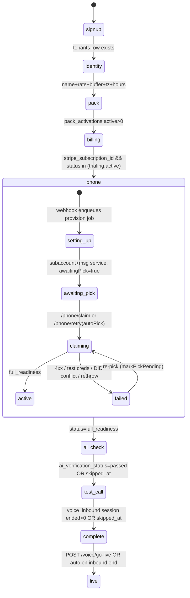

# D — Onboarding state machine (function level), failure modes, timing

Paths are relative to `/home/user/Serviceos/packages/api/src` (API) and `/home/user/Serviceos/packages/web/src` (web) unless absolute.

## 1. Status derivation

**Order and rules** — `onboarding/derive-status.ts`:

| step | done when | source |
|---|---|---|
| signup | `tenantExists` (tenants row) | L95 |
| identity | businessName && jobBufferMinutes!=null && hourlyRateCents!=null && timezone truthy && businessHours is a non-empty object | `isIdentityDone` L77-84 |
| pack | `pack_activations` with status='active' > 0 OR `settings.activeVerticalPacks.length>0` | L97; `load-facts.ts` L100 |
| billing | `stripe_subscription_id` set AND status ∈ {trialing, active} | `isBillingDone` L86-87 |
| phone | `tenant_integrations.status === 'full_readiness'` (provider='twilio') | L98 |
| ai_check | `ai_verification_status==='passed'` OR `ai_verification_skipped_at` not null | L100 |
| test_call | `COUNT(voice_sessions WHERE channel='voice_inbound' AND ended_at IS NOT NULL) > 0` OR (`onboarding_test_call_skipped_at` set AND count==0) | L89-91, L101 |

Order is hard-coded `['signup','identity','pack','billing','phone','ai_check','test_call']` (L109); `currentStep` = first not-done (L110). Per-step status overrides: phone `failed` → `error` + blocker `twilio_provisioning_failed` (L120-122); ai_check: passed→done, skipped→`skipped`, failed→`error` with blocker `ai_verification_failed`/`ai_config_missing` + `metadata.error` (L123-141), current carries `metadata.verifying` (L143); test_call skipped → `skipped` (L147-149); phone carries `metadata.{phoneNumber,lineState,pendingNumber}` (L112-117).

**Facts** — `onboarding/load-facts.ts` L29-75, one `Promise.all` on the request-scoped RLS client (L27): `settingsRepo.findByTenant`; `SELECT status,last_error,provider_data FROM tenant_integrations WHERE provider='twilio'` (L31-35); `SELECT stripe_subscription_id, subscription_status, created_at FROM tenants` (L36-39); inbound session count (L40-44); `tenant_settings` columns business_hours, job_buffer_minutes (defaulted through `effectiveBufferMinutes`, L93), hourly_rate_cents, timezone, onboarding_test_call_skipped_at, onboarding_upgrade_prompt_shown_at, voice_agent_live_at, activated_at, ai_model, ai_verification_* (L48-69); `pack_activations` count (L70-74). Phone line state comes from `toPhoneLineView` (`onboarding/phone-line.ts` L49-79): no row→`not_started`; `full_readiness`→`active`; `failed`→`failed`; `t0_requested` + `pendingPick`→`claiming` (pendingNumber null for `'auto'`), + `awaitingPick`→`awaiting_pick`, else `setting_up`; anything else→`unavailable`.

**Response shape** — `onboarding/contracts.ts` L149-167: `{ steps: [7 × {id,status∈done|current|pending|error|skipped,blockers?,metadata?}], currentStep|null, isComplete, voiceAgentLive, tenantId, subscriptionStatus, upgradePromptShownAt?, activatedAt?, accountCreatedAt? }`. The `.length(7)` is pinned in the Zod schema (L150). `GET /api/onboarding/status` (`routes/onboarding.ts` L155-228) has a no-pool "soft" branch that fabricates identity-done when a business name exists (L162-213).

**Shell** — `components/onboarding/v2/OnboardingShell.tsx`: polls every 3 s (L50, `hooks/useOnboardingStatus.ts` L95-158 with 2 s coalescing cache L54). Shown step = `override ?? data.currentStep` (L77); fallback `'test_call'` (L296). The owner can jump anywhere: `Sidebar.tsx` L118-124 calls `onSelect` for any step (a `ConfirmDialog` only for re-editing done identity/pack, L116-117, L189-203); `handleSelect` sets `override` (L303-306). PhoneStep's Continue sets `override='ai_check'` (L349). Completed tenants bounce to `/` unless `?rerun=1` (L58-60, L291-294). `ProtectedRoute.tsx` L126-134 soft-gates the CRM only on identity done; `/inbox` is always allowed (L111-124). Mobile strip `MobileProgress.tsx` is display-only (no jumping).

**Skip persistence** — no progress table. Test-call skip → `tenant_settings.onboarding_test_call_skipped_at` (`routes/onboarding.ts` L451-521, audit `tenant.test_call_skipped`); AI-check skip → `tenant_settings.ai_verification_skipped_at` (L1022-1071). "Talk it through" mode is `localStorage` per tenant (`OnboardingShell.tsx` L100-126). Conversation sessions persist in `onboarding_sessions` (`db/onboarding-session-repository.ts`).

## 2. Step components (`components/onboarding/v2/steps/`)

**IdentityStep.tsx** — H1 "Tell us about your business" (L181); CTA "Save and continue" (L387). Fields: business name (required, L192-197), cell phone (optional, L204-211), service address, ZIPs, services offered, service area text + radius (L216-269), time zone select pre-filled from `Intl` (L38-44, L275-282), 7-day hours grid default Mon–Fri 08–17 (L28-36, L292-326), travel buffer (L335-343), hourly rate (required, L354-362). Client validation: ≥1 day (L136-139). Server 400 `issues[]` rendered in a red alert (L165-168, L367-378); network error likewise. Preloads `/api/settings/` (L86-118). PUT `/api/onboarding/identity` (`routes/onboarding.ts` L230-383; owner-only; timezone IANA-validated L268-277; owner phone E.164 L283-303; seeds `ai_model` L310; audit `tenant.identity_set`). ~3–5 min on a phone (hours grid and `type=time` inputs are the slow part).

**PackStep.tsx** — H1 "Pick your trade" (L143); card tap is the CTA; "Other" opens a text field, CTA "Set up my trade" (L216). Error shows only `HTTP <status>` (L120, L223-227). POST `/pack` runs `activatePackWithSeed` under a per-tenant lock; 409 `PACK_ACTIVATION_IN_PROGRESS` (L385-449). ~20 s.

**BillingStep.tsx** — H1 "Start your 14-day free trial" (L119); CTA "Start 14-day free trial" / "Opening Stripe checkout…" (L206). Benefit copy L131: "20 AI answering minutes a month on Starter (60 on Growth); $1.25/min after". Loads `/billing/plans` (L53), 503/400 messages via `friendlyBillingError` (L26-31), redirects `window.location.href` to Stripe (L105). Return URL `/onboarding?billing=ok|cancel` (`routes/onboarding.ts` L1152-1153); shell toasts and refetches (`OnboardingShell.tsx` L128-167). **There is no "waiting for Stripe" state**: until the webhook flips `subscription_status`, the owner lands back on the plan picker, and a second click 400s "checkout in progress" (`createTrialCheckoutSession` pending-checkout gate). ~2–3 min + webhook latency.

**PhoneStep.tsx** — four renders: error "We hit a snag with your number" (L119-121, blocker copy L38-47, inline `NumberPicker` + "Or let us pick a number for you" L136); `awaiting_pick` "Pick your business number" / CTA "Pick one for me" (L151, L168); provisioning "Claiming your phone number" with "Usually takes about 30 seconds. This page refreshes automatically." and a 30 s "Still working" cue (L187-198, L74-79); ready "Your business number is ready" (L214) + carrier forwarding codes (L28-36, L243-261: `*72`, `**21*1…#`, `*73`/`##21#`) + amber "the AI doesn't start answering until you turn it on" (L265-266) + "Continue" (L270). Note the `setting_up` state (checkout job before `awaitingPick` lands) shows the "Claiming…" copy although nothing is being bought. ~1–2 min + two background jobs.

**AiCheckStep.tsx** — done "AI verified" / "Your AI assistant answered the test prompt correctly. Ready to take real calls." (L95, L102) — overstated: the worker sends `'ping'` with `maxTokens:16` (`workers/verify-ai.ts` L95-100). error "Verify your AI" + blocker copy (L23-28), CTA "Retry verification", link "Skip for now" (L131-133); skipped "AI check skipped" (L145); pending "We check your AI right after your trial starts. Finish the earlier steps first — nothing is running yet." + "Go to <step>" (L172-180); current "Verifying your AI" / "Running the check… usually a few seconds." (L191-199). Embeds `VoiceConfigPanel` ("Choose your agent's voice", PUT `/voice`, comment still says "pushes it onto the tenant's Vapi assistant" L16) and `VoiceApprovalPinPanel` (L204-205). Seconds, usually already passed.

**TestCallStep.tsx** — H1 "Make a test call" / "Call your Rivet number from your phone. We'll detect it and let you turn on AI answering for real." (L159-162); number is a `tel:` link (L42, L172-178) + Copy; "Waiting for your call…" → after 60 s "No call detected yet. Try calling again — or skip and turn it on manually." (L71-76, L200-206); "Turn on AI answering" (L212-214) POSTs `/api/voice/go-live` (L80-91); ghost "Skip — I'll test later" (L224) POSTs `/test-call/skip`. **The owner is never told what to say or what should happen.** Done: "You're live" / "Setup complete" (L117), copy L126-137, `CalendarChoicePanel` ("Connect your calendar", POST `/calendar/choose`, Google OAuth redirect, `CalendarChoicePanel.tsx` L34-49, L69), CTAs "Turn on AI answering" / "Go to dashboard" (L144-148).

**ConversationStep.tsx** — "Talk it through" (L102), mic via `useConversationVoice`, typed fallback; on completion "Setup captured. Check your inbox to review and approve the proposals…" + "Continue setup" (L189-193).

Stale copy: `workers/setup-reminder-sweep.ts` L188-196 says "Pick your trade (HVAC or plumbing)" and "Forward your phone line to Rivet" (phone step is really "pick a number"); `voice/check-upgrade-nudge.ts` L12 "100-minute trial cap" and unused `UPGRADE_THRESHOLD_MINUTES = 30` (L14) vs. `TRIAL_TOTAL_SECONDS = 60*60` (`voice/trial-limits.ts` L19-22); FUNNEL.md L69-75 presents Vapi as live while the worker treats it as optional (`workers/provision-twilio.ts` L606-675) and FUNNEL.md L99-103 vs L130-131 contradict on whether identity-based activation is primary or deferred.

## 3. Phone provisioning

Job type `provision_twilio_subaccount` (`workers/provision-twilio.ts` L68); payload `{tenantId, region, baseUrl, phoneNumber?, autoPick?, changeTo?}` (L51-66). Enqueued (a) by the Stripe `customer.subscription.*` webhook once status is trialing/active, key `provision-twilio-<tenant>` with no number (`webhooks/routes.ts` L2617-2660, alongside `verify-ai-<tenant>`), (b) `/phone/claim` key `provision-twilio-claim-<tenant>-<digits>` (`routes/onboarding.ts` L838-842), (c) `/phone/retry` → `autoPick` key `provision-twilio-autopick-<tenant>` (L686-690), (d) `/phone/change` (L867-966). All run under one per-tenant advisory lock; contention throws so the queue retries (L85-130).

Row state machine (`tenant_integrations.status`): *(no row)* → `t0_requested` (upsert L285-298, or `markPickPending` from the routes L76-93 which also clears `failed`) → subaccount created (L302-327) → Messaging Service (L331-349) → **stop with `awaitingPick:true` when no number requested** (L357-371, D-037) → purchase (L373-469; auto-pick picks area code from `business_address` state, `integrations/twilio/provisioning.ts` L9-20, L176-194) → attach to Messaging Service (L584-604) → optional Vapi assistant, failure-soft (L606-675) → `full_readiness` + `provisioned_at`, strips `pendingPick`/`awaitingPick` (L677-687), seeds `business_phone` (L689-699). "full_readiness" means: subaccount + messaging service + a purchased, attached number persisted in `provider_data.{messagingServiceSid, phoneNumberSid, phoneE164, numberAttached}`. A2P 10DLC (D-038, `docs/decisions.md` L1439-1463) lives in `a2p_registrations` and mirrors into `provider_data.a2p10dlc`; it never changes this column.

Terminal `failed` (no retry): claimed number 4xx≠429 at purchase ("no longer available", L437-463); Twilio returned a magic test number = test credentials (L479-498); DID already held by another tenant, number released (L511-581). Any other throw → `failed` + rethrow so the queue retries with backoff (L702-715); the row flips back to `t0_requested` only on the next run's upsert. Pre-gates: missing master creds in non-deployment env → stub `+15005550006` with `full_readiness` (L181-213, `STUB_DEV_PHONE_E164` L33); missing `TENANT_ENCRYPTION_KEY` → silent return in non-deployment (L216-222); billing not live → silent skip (L231-246). Twilio HTTP timeout 20 s (`provisioning.ts` L28). The `classifyTwilioError`/`TwilioProvisioningClient` ladder (L272-375) is a parallel abstraction the worker does not use; it string-matches `→ <status>:` instead (L435).

Recovery docs: `docs/plans/2026-09-08-twilio-recovery.md` — Clerk `user.created` retry skipped the enqueue because it was gated on `result.created`; fix un-gated it (L33-40, L109-117). `docs/plans/2026-09-08-provisioning-recovery.md` — same bug on the still-unwired `provisioningQueue` ("root provisioning"), plus fire-and-forget `send()` swallowed queue outages; now awaited with a 10 s race (L328-343); `provisioningQueue` remains unwired in `app.ts` (L435-438). Note the Clerk-time Twilio enqueue those docs fix is now superseded by the checkout-time enqueue (the worker skips until billing is live).

## 4. Voice gate and go-live

`voice/voice-gate.ts` decision order: (1) `past_due` within `past_due_grace_until` → allow (L75-77); (2) status ∉ {trialing, active} → block `no_billing` (L79-87); (3) `voice_agent_live_at` null → **owner bypass**: `isOwnerLineAttested(stirVerstat)` AND `from` matches `tenant_settings.owner_phone` or `business_phone` (last-10-digit compare, `voice/activation.ts` L196-203) → allow (L112-114); else block `not_live` (L115-121); (4) trialing: concurrent ≥2 → `trial_cap_concurrent`, billable ≥3600 s → `trial_cap_total`, forward to `owner_phone` (L132-158; `trial-limits.ts` L1-3, L19-22, L39-49); (5) paid: overage cap → `overage_cap` forward (L164-180). Attestation: only `TN-Validation-Passed-A` passes (`telephony/stir-attestation.ts` L20-25); `-B`, `-C`, failed, or absent → bypass denied → voicemail. Blocks write `voice_blocked_*`/`voice_forwarded_*` audit rows (L197-224).

Caller experience when blocked (`routes/telephony.ts` L487-523, L1633-1652): `not_live` → "This line isn't using our AI assistant yet. Please leave a message after the tone."; `no_billing` → "We're finishing account setup…"; gate exception fails closed to `not_live` (L514-522); caps `<Dial>` the owner. Because `business_phone` defaults to the tenant's own DID (worker L689-699), the "owner's number" match is satisfied by a spoofed From=To, which is exactly why attestation is required.

Go-live (`voice/go-live.ts`): manual `POST /api/voice/go-live` needs `tenant:manage` and a trialing/active subscription (402 otherwise) (`routes/voice.ts` L759-781); `enableVoiceAgentLive` is a check-and-set on `voice_agent_live_at IS NULL` + audit `tenant.voice_agent_live` (L24-64); `pause` nulls it (L66-86). `maybeAutoGoLiveOnInboundEnd` (L88-104) flips live on **any** ended `voice_inbound` session when the subscription allows and not yet live — wired in `app.ts` `onSessionEnded` (L3982) after the usage ledger, upgrade nudge (L4094) and usage alerts, before activation (L4112-4130). Since the only inbound call that can end while not-live is an attested owner call, auto-go-live is effectively "owner's test call ended ⇒ live", with no verification that the call went well.

Activation (`voice/activation.ts` L72-193): count heuristic, threshold `onboarding_test_call_skipped_at ? 1 : 2` (L121), requires live + subscription, check-and-set `activated_at`, emits `first_real_call_received` + email. Identity-based variant L215-299 (unused by the Twilio path). Upgrade nudge (`check-upgrade-nudge.ts` L42-96): trialing, ≥2400 billable s, once, stamps `onboarding_upgrade_prompt_shown_at`.

## 5. Test call and the in-app voice FSM

Detection = the 3 s status poll noticing `inboundCallCount > 0`, i.e. a `voice_sessions` row with `channel='voice_inbound'` and `ended_at` (written by the telephony adapter at hangup, `telephony/twilio-adapter.ts` L1094-1099 create; processor `markEnded`). Nothing checks the call's outcome, duration, or caller. The only "go" signal is the tel: link; `test_call_initiated` fires on tap/copy (`TestCallStep.tsx` L47-52).

In-app sessions (`routes/voice-sessions.ts` L71-94, `ai/agents/customer-calling/inapp-adapter.ts` L1229-1310): `store.create(tenantId,'inapp', …)` (L1256), persisted as `channel:'inapp_voice'` (L1292), caller treated as already identified so `ask_caller` is skipped (L1305-1307), actor = the signed-in user (L1270), `ownerSession` when role owner (L1241). `classifierProfileForSession` (`ai/voice-turn/create-voice-turn-processor.ts` L643-647) maps the trusted `inapp` channel to the **`operator`** profile (or `owner_line`), never `caller` (D-028, `docs/decisions.md` L714-726). `inapp_voice` is excluded from `inboundCallCount` and activation (`activation.ts` L81). The web surface is `components/assistant/VoiceSessionPanel.tsx` — text-only by its own header (L1-13), rendered on `pages/sessions/SessionFocusPage.tsx`; TTS audio returns base64 (`voice-sessions.ts` L86-92, L120-121). So: same `CallingAgentStateMachine`, but an **owner surface**. A browser "test call" against the caller FSM needs a new session mode (`channel:'inapp_voice'`, `preview:true`) that `isUntrustedS1Session` treats as untrusted with no actor so the profile resolves to `caller`, runs the inbound greeting path (`disclose_recording`, `ask_caller`), and is tagged so the ledger/activation ignore it.

## 6. Talk-through

`routes/onboarding-conversation.ts` L307-343: `POST /turn {sessionId?, userMessage?, clientTimezone?}` → `OnboardingConversationOrchestrator.turn`. FSM states profile → category → pricing → team → schedule → tools → review → completed|capped (`ai/agents/onboarding/transitions.ts` L35-56, L58-70), `MAX_TURNS=15` (`constants.ts` L16). Extractors fill (`ai/tasks/onboarding/types.ts`): businessName/city/state/verticalPacks/serviceDescriptions (L35-43), categories (L45-55), prices with `priceType` incl. `hourly_rate` (L57-70), team (L72-82), workingHours + SLA (L85-102), tools (informational only, L104-121). Proposals: `onboarding_tenant_settings` (businessName, city, state, verticalPacks, hourlyRateCents, timezone; gated via `missingFields` on verticalPacks/hourlyRateCents/timezone, `tenant-settings-proposer.ts` L131-231), `onboarding_service_category`, `onboarding_estimate_template`, `onboarding_team_member` (email-gated), `onboarding_schedule`. Review happens in `/inbox` (proposals queue); execution handlers write through the same `upsertIdentityFields` / `activatePackWithSeed` as the forms (`proposals/execution/onboarding-handlers.ts` L13-14, L188, L226, L644). No extractor captures FAQ-style answers (emergency policy, deposits, warranty, what not to book); `serviceDescriptions` and `sla` are the closest. A business-answers table could be filled by one more capture state + an `onboarding_business_answers` proposal type using the same gate idiom.

## 7. Lifecycle

`workers/setup-reminder-sweep.ts`: hourly (`app.ts` L7227-7240), tenants ≥24 h old with no `lifecycle_emails(kind='setup_reminder')` and `activated_at IS NULL` (L224-236); re-derives status and emails outstanding step labels (L283-327). `workers/trial-reminder-sweep.ts`: hourly, windows 3d/1d/0d on `trial_ends_at` (L395-402). `middleware/tenant-context.ts` L234-270: a signed-in user with no `tenant_id` claim is recovered from `users.clerk_user_id` and Clerk metadata back-filled (L77-118); no users row → 403 `ACCOUNT_SETUP_INCOMPLETE`. **No client handles that code** (grep of `packages/web/src` is empty) — the user sees the generic "We couldn't load your setup" (`OnboardingShell.tsx` L269-285) until the Clerk webhook lands. `bootstrapTenant` (`auth/clerk.ts` L597-640) creates the tenant (`name: "<local>'s Organization"`) and `ensureTenantSettings` (`settings/settings.ts` L1294-1339): `business_name='My Business'`, prefixes, numbering, language en, `ai_model=resolveBootstrapAiModel()`, **no timezone**, no feature flags, no subscription fields. `routes/admin-tenants.ts` L105-139: platform-admin-only `GET /:tenantId/usage` (AI runs/tokens, voice minutes, audit activity), audited.

## 8. Instrumentation

Client registry `lib/analytics.ts` L25-70; `trackFunnel` stamps tenant_id/user_id/timestamp/source (L148-161). Shell emits `wizard_started`, `onboarding_step_viewed` (+ mapped `wizard_step_business|phone|voice`), `onboarding_step_completed`, `onboarding_completed` + `wizard_completed` (`OnboardingShell.tsx` L31-35, L175-234); TestCallStep `test_call_initiated/succeeded`, `voice_agent_turned_on`; CalendarChoicePanel `wizard_step_calendar`. Server (`analytics/posthog.ts` L32-47, L162-170): `signup_completed` (`webhooks/routes.ts` L971), `trial_started`/`trial_to_paid` (L2583-2596), `plan_selected` (`routes/onboarding.ts` L1176-1180), `trial_minutes_milestone`, `first_real_call_received`. FUNNEL.md's table matches the code; `pack`/`billing`/`test_call` have no `wizard_step_*` name. `docs/posthog-instrumentation-strategy.md` §0 (L17-33): nothing reaches PostHog because `POSTHOG_API_KEY`/`VITE_POSTHOG_KEY` are not set in production (both wrappers are no-ops without a key, `posthog.ts` L96-125, `analytics.ts` L78-84).

## 9. Timing (owner on a phone)

signup 1–2 min → identity 3–5 → pack 0.5 → billing 2–3 + Stripe webhook (seconds; UI shows the picker again meanwhile) → phone: checkout job (subaccount + messaging service, ~5–15 s; UI "Claiming your phone number" until `awaitingPick` lands) → pick 1 min → claim job ~10–30 s ("Claiming +1…", 30 s cue) → ai_check: `verify-ai` was enqueued at the webhook, normally already passed; if the gateway is slow "Running the check…" → test call 1–2 min + hangup detection ≤3 s ("Waiting for your call…", 60 s cue) → go-live tap. ~12–20 min total; four background waits (Stripe webhook, setup job, claim job, verify_ai) plus the inbound-session end.

## 10. Current flow (mermaid)

## 11. Failure-mode table

| step | failure | owner experience | recovery today | sev |
|---|---|---|---|---|
| signup | Clerk webhook late/failed | 403 `ACCOUNT_SETUP_INCOMPLETE` unhandled → "We couldn't load your setup", Try again | webhook retry; `recoverTenantFromUsersRow` only if a users row exists | high |
| identity | no timezone (conversation path) | identity never done, bounced to form | fill proposal gate / form | med |
| pack | seed lock contention | 409 shown as "HTTP 409" | retry tap | low |
| billing | webhook delay after Stripe success | plan picker reappears; second click 400 "checkout in progress" | wait for poll | high |
| billing | cancel + cleanup failure | toast, gate stuck ≤30 min | retry later | med |
| phone | Twilio creds missing in prod | job throws, retries forever; step shows "Claiming…" indefinitely | ops | high |
| phone | `TENANT_ENCRYPTION_KEY` missing (non-prod) | silent return, row stays `t0_requested`, "Claiming…" forever | none | med |
| phone | claimed number taken | error card "no longer available", picker again | re-pick | low |
| phone | test credentials / DID conflict | generic "We couldn't claim a phone number… team alerted" | ops | high |
| phone | checkout job not yet run (`setting_up`) | misleading "Claiming your phone number" copy | wait | low |
| ai_check | `ai_model` null | error `ai_config_missing` | retry (self-heals via COALESCE) or skip | low |
| ai_check | gateway down | error with raw message | retry / skip | med |
| test_call | owner's carrier gives B/C/no attestation | voicemail "This line isn't using our AI assistant yet"; step waits forever | skip + blind "Turn on AI answering" | high |
| test_call | owner calls from a non-registered phone | same voicemail | enter cell in identity, retry | med |
| test_call | call connects but AI misbehaves | step still "done"; auto-go-live flips live | pause from Settings | high |
| go-live | manual before any test | allowed (only billing checked) | — | med |
| all | PostHog keys unset | no funnel data | set keys | med |

## 12. Spec for the reordered flow

> **Superseded in part (2026-10-16, same day).** This section was written before U9. The
> plan's final order is `signup → identity → pack → voice_preview → scenario_interview →
> billing → phone → test_booking → go_live`: the `business_answers` step and its key/value
> completion rule below are replaced by `scenario_interview`, complete when every selected
> core scenario has an `answered` or `skipped` row in `onboarding_scenario_answers` (the U4
> `tenant_business_answers` table remains as storage the interview writes into). Go-live is
> gated on that predicate, not on answer keys. The facts, routes and tests below still apply
> except where they name `business_answers`; the plan (U6 items 9–10, U9) is authoritative.

**New `derive-status` order** (as first drafted; see the note above — `business_answers` became `scenario_interview`): `['signup','identity','pack','voice_preview','business_answers','billing','phone','test_booking','go_live']`. Rules:

- `voice_preview`: `tenant_settings.voice_preview_at IS NOT NULL` (stamped when a preview session produced a greeting through the gateway; subsumes `ai_check` — delete `verify_ai` enqueue in `webhooks/routes.ts` L2632-2634 and the worker, or keep it only for Settings).
- `business_answers`: all `REQUIRED_ANSWER_KEYS` present in `business_answers` (new table, migration `310_business_answers`: `id, tenant_id, key text, answer text, source enum(form,conversation), updated_at`, unique `(tenant_id,key)`, FORCE RLS). Keys: `service_area`, `emergency_policy`, `after_hours`, `pricing_disclosure`, `booking_rules`, `do_not_book`, `payment_terms`.
- `billing`, `phone`: unchanged.
- `test_booking`: `test_booking_verified_at IS NOT NULL` OR `onboarding_test_call_skipped_at` (rename column later). `rejected_at` → status `error`, blocker `test_booking_rejected`, metadata `{reason}`.
- `go_live`: `voice_agent_live_at IS NOT NULL`. `isComplete` = all done; `voiceAgentLive` stays for the banners.
- Error overrides: keep phone/ai mapping; add `forwarding` as **metadata on `go_live`** (`forwardingCheckStartedAt`, `forwardingVerifiedAt`), not a gate.

**New facts** (`load-facts.ts`): `voice_preview_at`, `business_answers` count/keys (one `SELECT key FROM business_answers WHERE tenant_id=$1`), `test_booking_verified_at`, `test_booking_rejected_at`, `test_booking_reason`, `test_booking_session_id`, `forwarding_check_started_at`, `forwarding_verified_at` (all `tenant_settings`, migration adds them). `OnboardingStepIdSchema` and `steps.length(9)` in `contracts.ts`; mirror in `web/src/types/onboarding.ts`.

**Routes** (all `requireAuth, requireTenant, requireRole('owner')`, audited):

- `POST /api/onboarding/voice/preview` `{scenario?: 'new_customer'|'emergency'|'quote'}` → starts an `InAppVoiceAdapter` session with a new `preview: true` option: `channel:'inapp_voice'`, no `actorUserId`, `ownerSession:false`, so `classifierProfileForSession` returns `caller`; runs the inbound greeting/`ask_caller` path with `From` = owner's phone; returns `{sessionId, greetingText, greetingAudio}`. On first success stamps `voice_preview_at`. Preview sessions carry `context.preview=true` so `recordCallEnded`, activation and auto-go-live ignore them. Turns reuse `/api/voice/sessions/:id/input`.
- `PUT /api/onboarding/business-answers` `{answers: [{key, answer}]}` Zod: key ∈ enum, answer 1–500 chars; upsert; returns the full set + `missingKeys`. The conversation path gets an `answers_capture` state + `onboarding_business_answers` proposal whose handler calls the same upsert.
- `POST /api/onboarding/test-booking/verify` `{sessionId}` / `.../reject` `{sessionId, reason}`: session must belong to the tenant, be `voice_inbound` or preview, and have an `appointments` row linked to it (verify) — 409 `TEST_BOOKING_NO_APPOINTMENT` otherwise; stamps the columns; verify also deletes/flags the test appointment (`is_test=true`).
- `POST /api/onboarding/forwarding-check/start`: stamps `forwarding_check_started_at`, returns carrier codes + the owner's expected `ForwardedFrom`; `routes/telephony.ts` `/voice` sets `forwarding_verified_at` when `body.ForwardedFrom` is present and matches `owner_phone`/a registered line.

**`go-live` must check** (`voice/go-live.ts` `enableVoiceAgentLive`, called by `routes/voice.ts` L759 and the auto path): subscription live (existing), `tenant_integrations.status='full_readiness'`, `voice_preview_at`, business answers complete, `test_booking_verified_at` (or `onboarding_test_call_skipped_at` plus `force:true` in the body, audited as `tenant.voice_agent_live {forced:true}`). Return 409 `GO_LIVE_BLOCKED {blockers:[…]}`. `maybeAutoGoLiveOnInboundEnd` becomes a no-op unless `test_booking_verified_at` is set (or is removed; the verify route calls `enableVoiceAgentLive` itself with `source:'test_booking_verified'`). Keep the #1605 attested-owner bypass in `voice-gate.ts` — it is what lets the real-phone test booking happen pre-live.

**Tests that change**: `test/onboarding/derive-status.test.ts` (order cases, "has 7 steps in order" L254, every `phone→ai_check→test_call` expectation); `test/proposals/onboarding-contracts.test.ts` + `contracts.ts` `.length(7)`; `test/integration/onboarding-status.test.ts` L65 ("all 7 steps"), `onboarding-status-derived-gate.test.ts`, `onboarding-ai-check.test.ts`, `onboarding-test-call-skip.test.ts`, `onboarding-activation.test.ts` (threshold still keyed on the skip column); `test/voice/go-live.test.ts` (blockers, auto path), `test/telephony/telephony-voice-gate-owner-test-call.test.ts` (unchanged behaviour, add preview case); `test/routes/onboarding-billing.route.test.ts` (webhook no longer enqueues verify_ai); web: `OnboardingShell.*.test.tsx`, `Sidebar.*.test.tsx`, `MobileProgress.voice.test.tsx` (labels), `AiCheckStep.test.tsx` (retire), `TestCallStep.funnel.test.tsx` (events renamed `test_booking_*`), `CalendarChoicePanel.funnel.test.tsx`; `workers/setup-reminder-sweep` labels + test; FUNNEL.md event table. New: unit tests for the new rules, a Docker-gated integration test pinning the new columns/table, a handler-level test for the preview session using a mocked gateway.
